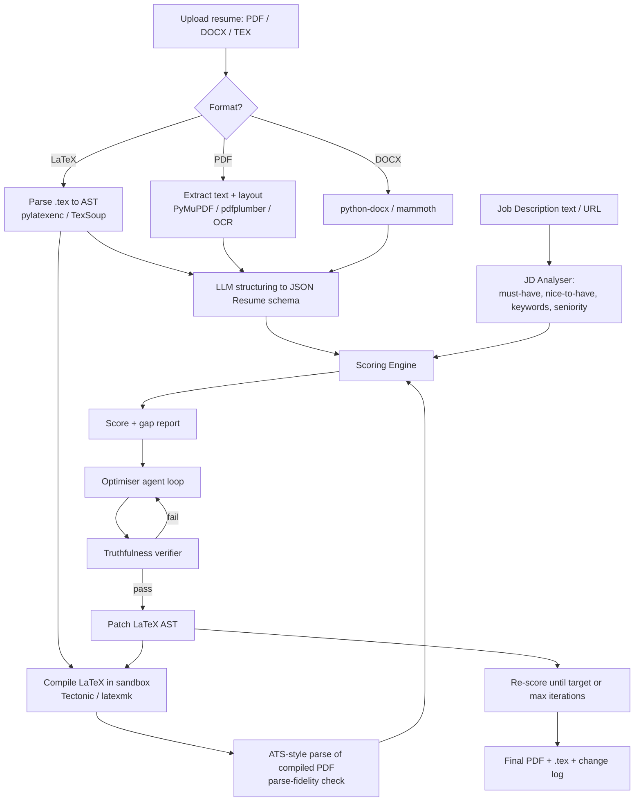

# AI ATS Score & Resume Optimiser Engine (with LaTeX Support)

Architecture, tech stack, and tooling plan.

---

## 1. Goal & Reality Check

**Goal:** Given a resume (PDF / DOCX / LaTeX) and a Job Description (JD), the engine:

1. Scores how well the resume would pass an ATS + recruiter screen for that JD.
2. Explains the gaps (missing skills, weak bullets, parsing issues).
3. Rewrites / optimises the resume, truthfully, to maximise the match, and outputs a clean ATS-safe PDF + LaTeX source.

**Important reality check (design around this):**

- There is **no universal ATS score**. Workday, Greenhouse, Lever, iCIMS, Taleo, etc. mostly *parse, store and rank/search*. Few auto-reject purely on a number. Your score is therefore a **calibrated proxy**, not ground truth.
- Real-world screening has three layers, and your engine should model all three:
  1. **Parsing** – can the ATS extract your name, contact, titles, dates, skills correctly?
  2. **Matching** – keyword / skill / semantic overlap with the JD.
  3. **Recruiter read** – impact, clarity, seniority fit.
- **Guardrail:** The optimiser must never fabricate experience, employers, titles, dates, degrees, or metrics. Keyword stuffing and hidden white text are detectable and get candidates rejected. Build truthfulness into the architecture (see Section 6).

---

## 2. Core Design Principle for LaTeX

> **Edit the source. Score the output.**

| Concern | Operate on | Why |
|---|---|---|
| Editing / rewriting | LaTeX **source (AST)** | Preserves macros, layout, and lets you diff precisely |
| Scoring parseability | Compiled **PDF → extracted text** | This is what an ATS actually sees |

LaTeX PDFs commonly break ATS parsing because of: ligatures (`fi`, `fl`), missing Unicode mapping, icon fonts (FontAwesome), multi-column layouts, `tabular` used for layout, text in images, and odd reading order. The engine must **compile, extract, and compare** to detect these.

**ATS-safe LaTeX preamble (pdfLaTeX):**

```latex
\documentclass[11pt,letterpaper]{article}
\usepackage[T1]{fontenc}
\usepackage[utf8]{inputenc}
\usepackage{lmodern}
\input{glyphtounicode}   % maps glyphs -> Unicode for text extraction
\pdfgentounicode=1       % embeds the ToUnicode map
\usepackage[hidelinks]{hyperref}  % keep visible link text (no icon-only links)
```

For XeLaTeX / LuaLaTeX / Tectonic: use `fontspec` with a standard font; Unicode mapping is handled by the engine, but still test extraction.

---

## 3. High-Level Architecture

```
┌────────────────────────────────────────────────────────────────────┐
│                         CLIENT (Next.js)                           │
│  Upload (PDF/DOCX/TEX) · JD paste/URL · Score dashboard · Diff     │
│  Monaco LaTeX editor · Live PDF preview · Accept/Reject per bullet │
└───────────────────────────────┬────────────────────────────────────┘
                                │ REST / WebSocket (SSE for streaming)
┌───────────────────────────────▼────────────────────────────────────┐
│                     API GATEWAY (FastAPI)                          │
│        Auth · Rate limit · Job orchestration · Validation          │
└───┬───────────────┬────────────────┬──────────────────┬────────────┘
    │               │                │                  │
┌───▼─────┐   ┌─────▼──────┐   ┌─────▼───────┐   ┌──────▼─────────┐
│ INGEST  │   │ JD ANALYSER│   │  SCORING    │   │   OPTIMISER    │
│ & PARSE │   │            │   │  ENGINE     │   │   (agentic)    │
│ service │   │ skills,    │   │ hybrid:     │   │ plan → rewrite │
│         │   │ must/nice, │   │ rules + NLP │   │ → verify →     │
│ PDF     │   │ seniority  │   │ + embeddings│   │ re-score loop  │
│ DOCX    │   │ taxonomy   │   │ + LLM judge │   │                │
│ LaTeX   │   │ mapping    │   │             │   │                │
└───┬─────┘   └─────┬──────┘   └─────┬───────┘   └──────┬─────────┘
    │               │                │                  │
┌───▼───────────────▼────────────────▼──────────────────▼───────────┐
│              CANONICAL RESUME / JD STORE (JSON Resume schema)      │
│        Postgres + pgvector · Redis (cache/queue) · S3/MinIO        │
└───────────────────────────────┬────────────────────────────────────┘
                                │
┌───────────────────────────────▼────────────────────────────────────┐
│           LATEX RENDER WORKER (isolated sandbox container)         │
│  Tectonic / TeX Live · latexmk · chktex · SyncTeX · no network     │
│  Output: PDF + extracted-text via multiple "ATS-like" parsers      │
└────────────────────────────────────────────────────────────────────┘
        Cross-cutting: Observability · Evals · Security · Privacy
```

### Pipeline flow (Mermaid)



---

## 4. Components in Detail

### 4.1 Ingestion & Parsing Service

| Input | Strategy | Libraries |
|---|---|---|
| **LaTeX (.tex / .zip)** | Parse to AST for editing; compile to PDF for scoring. Detect main file, resolve `\input`, `\include`, custom macros (e.g. `\resumeItem`, `\resumeSubheading`). | `pylatexenc` (LatexWalker with custom macro specs), `TexSoup`, `pandoc` (tex → JSON AST) |
| **PDF (text-based)** | Text + bounding boxes, reading-order reconstruction, multi-column detection | `PyMuPDF (fitz)`, `pdfplumber`, `pdftotext` (poppler), `Docling`, `Unstructured` |
| **PDF (scanned)** | OCR fallback | `Tesseract`, `PaddleOCR`, `docTR` |
| **DOCX** | Paragraph/style/table extraction | `python-docx`, `mammoth` |

**Structuring step:** An LLM with JSON-schema-constrained output converts raw text into the canonical schema ([JSON Resume](https://jsonresume.org/schema/) recommended), validated with **Pydantic**. Keep a **mapping from each JSON field back to its source** (LaTeX line / PDF coordinates). Use **SyncTeX** to map PDF positions back to `.tex` lines, which is how you point to *exactly which source line* breaks parsing.

**LaTeX-specific parsing tips**

- Most resume templates use custom macros; ship a **macro registry** for popular templates (Jake's Resume, AltaCV, Awesome-CV, moderncv, RenderCV output) so the AST walker knows which arguments are "text content" and which are layout.
- Fallback when macros are unknown: compile → extract text → LLM maps text back to source regions.
- Strip comments (`%`) before analysing, but preserve them in output.

### 4.2 JD Analyser

Extracts from the JD:

- **Must-have vs nice-to-have** skills (look for "required", "must", "preferred", "bonus")
- Tools / technologies, certifications, years of experience, seniority level
- Responsibilities (converted to a list of "requirements" to match bullets against)
- Domain/industry terms and soft skills
- Knock-out criteria (location, work authorisation, degree, clearance)

**Normalisation:** map skills to a taxonomy so "K8s" = "Kubernetes", "JS" = "JavaScript", "ML" ≈ "Machine Learning". Sources: **ESCO**, **O\*NET**, **Lightcast Open Skills**, plus a custom alias table.

### 4.3 Scoring Engine (hybrid, explainable)

Do **not** rely on a single LLM "give me a score". Combine deterministic metrics, embeddings, and a constrained LLM judge so the score is reproducible and explainable.

| # | Component | Weight (default) | How it's computed |
|---|---|---|---|
| 1 | **Hard-skill / keyword match** | 30% | Exact + alias + lemma match against JD skills. Must-have weighted 2x nice-to-have. Evidence in an *experience bullet* scores higher than a bare "Skills" list mention. |
| 2 | **Semantic relevance** | 20% | Bullet-to-requirement similarity using embeddings + cross-encoder rerank. Catches paraphrases ("built CI pipelines" ≈ "DevOps automation"). |
| 3 | **Experience & seniority fit** | 15% | Years of relevant experience, title progression, recency, scope/leadership signals. |
| 4 | **ATS parseability & format** | 15% | Parse-fidelity check (see 4.4), standard section headings, contact info found, dates parsed, no tables/columns/images, sensible length. |
| 5 | **Impact & bullet quality** | 10% | Action verb + task + measurable result (XYZ/STAR pattern), quantification ratio, no weak phrases. |
| 6 | **Education & certifications** | 5% | Degree/cert match vs JD requirements. |
| 7 | **Readability & language** | 5% | Grammar, tense consistency, length, density. |

```
FinalScore = Σ (weight_i × subscore_i)     # each subscore normalised to 0–100

Caps (knock-outs):
  - Missing a hard must-have requirement  → cap at 70
  - Parse-fidelity < 60                   → cap at 60
  - Detected keyword stuffing / hidden text → penalty
```

**Skill matching tiers (example):**

| Match type | Credit |
|---|---|
| Exact match | 1.00 |
| Alias / synonym (taxonomy) | 0.95 |
| Embedding similarity ≥ 0.82 | 0.60 |
| Mentioned only in Skills list (no evidence in experience) | ×0.7 multiplier |

**Calibration (critical):** Weights above are starting points. Collect labelled data (resume + JD + recruiter outcome: shortlisted / rejected) and fit weights with logistic regression or gradient boosting, then check Spearman correlation between your score and outcomes.

**Example output**

```json
{
  "overall_score": 78,
  "grade": "Good - likely to pass screen with improvements",
  "breakdown": {
    "keyword_match": {"score": 72, "matched": ["Python", "AWS", "Docker"], "missing_must_have": ["Kubernetes", "Terraform"], "missing_nice_to_have": ["Go"]},
    "semantic_relevance": {"score": 80},
    "experience_fit": {"score": 85},
    "parseability": {"score": 90, "issues": ["Icon font in header not extractable (line 14)"]},
    "impact": {"score": 65, "weak_bullets": [3, 7, 11]},
    "education": {"score": 100},
    "readability": {"score": 88}
  },
  "knockouts": [],
  "recommendations": [
    {"priority": "high", "type": "missing_skill", "text": "JD requires Kubernetes. Your 'Deployed services on ECS' bullet could mention container orchestration if accurate."},
    {"priority": "medium", "type": "impact", "text": "Bullet #3 has no metric. Add scale, % improvement, or time saved."}
  ]
}
```

### 4.4 Parse-Fidelity Checker (the LaTeX differentiator)

Simulates what an ATS "sees":

1. Compile `.tex` → PDF in the sandbox.
2. Extract text with **2-3 independent extractors** (`pdftotext`, `PyMuPDF`, `Apache Tika`) since ATS vendors differ.
3. Compare to the canonical text from the source:
   - **Field recall:** name, email, phone, location, links, each job title / company / date range, degrees, skills
   - **Reading order:** sections appear in correct sequence; no column interleaving
   - **Garbage detection:** `�`, private-use Unicode, ligature glyphs, spaced-out letters ("P y t h o n")
   - **Section heading detection:** standard names (Experience, Education, Skills, Projects)
4. Output a **parse-fidelity score** + pinpointed issues (using SyncTeX to cite source lines).
5. Offer **auto-fixes**: inject `glyphtounicode`, replace icon fonts with text, flatten tables/columns, swap non-standard headings.

### 4.5 Optimiser (agentic loop)

```
INPUT: canonical resume JSON, LaTeX AST, JD analysis, score report, "Facts Bank"

loop (max N iterations, until score >= target or no further gains):
    1. PLANNER      → picks highest-impact gaps (missing must-haves, weak bullets, parse issues)
    2. REWRITER     → proposes bullet/summary/skills edits, grounded ONLY in resume + Facts Bank
    3. VERIFIER     → checks every claim is traceable to source; rejects invented facts/metrics
    4. PATCHER      → applies edits to LaTeX AST nodes (text only; macros untouched)
    5. COMPILER     → compile + lint (chktex); rollback patch if compile fails
    6. SCORER       → re-score; keep patch only if score improves
OUTPUT: optimised .tex + PDF + change log (before/after per bullet) + new score
```

**Optimisation techniques**

- Reorder bullets and sections by JD relevance (most relevant first).
- Rewrite bullets using strong action verbs + JD terminology (only where truthful).
- Tailor the **Summary** and **Skills** sections to the JD.
- Fix the parseability issues from 4.4.
- Trim to one page where appropriate (for early/mid career) via token-aware condensing.
- Use `[ADD METRIC: ...]` placeholders instead of inventing numbers; ask the user for real data.

**Truthfulness guardrails**

- **Facts Bank:** user-confirmed facts (tools used, scale, outcomes). Rewriter may only draw from resume + Facts Bank.
- **Verifier model/prompt:** for every changed bullet, answer "Is each claim supported by source text? yes/no + evidence". Fail closed.
- **Hard rules:** never add employers, titles, dates, degrees, certifications, or numeric metrics that aren't in the source.
- **Human-in-the-loop:** accept/reject every change; show a diff.
- **Anti-gaming:** no hidden text, no keyword dumps, cap keyword density.

**Example rewriter system prompt (excerpt)**

```text
You rewrite resume bullets to align with a job description.
RULES:
1. Use ONLY facts present in <resume> or <facts_bank>. Never invent tools, metrics, titles, or dates.
2. If a metric would help but is not provided, insert [ADD METRIC: what to quantify].
3. Use JD terminology only when it accurately describes the work done.
4. Format: strong past-tense verb + what + how/tools + measurable result. Max 2 lines.
5. Return JSON: {"bullet_id": ..., "original": ..., "rewritten": ..., "evidence_spans": [...], "jd_keywords_used": [...]}
```

### 4.6 LaTeX Render Worker (security-critical)

Compiling user-supplied LaTeX is a **remote code execution risk**. Treat it as hostile input.

- Run in an **isolated container** (gVisor / Firecracker microVM), **no network**, read-only filesystem except a temp dir, non-root user.
- **Shell escape disabled** (`-no-shell-escape`; Tectonic disables by default).
- Restrict file access: `openin_any=p`, `openout_any=p` in `texmf.cnf`; block `\write18`, `\input{/etc/...}`, `\openout`, `\immediate\write`.
- Hard limits: **10-20s timeout, 512 MB RAM, CPU quota, max output size, max pages**.
- Package allow-list (pre-install what you support; reject others).
- Use **Tectonic** for small images and on-demand package fetching at build time (pre-bundle packages offline for production), or **TeX Live (scheme-small + needed packages)** with `latexmk`.
- Return compile logs parsed into friendly errors; the optimiser must roll back on failure.

### 4.7 Privacy & Compliance

Resumes are PII-heavy.

- Encrypt at rest (S3 SSE, Postgres encryption) and in transit (TLS).
- Retention policy + one-click delete (GDPR / CCPA).
- Optional **PII redaction before LLM calls** (Microsoft Presidio) for names/phones/addresses; re-inject after.
- Use LLM providers with **zero-retention / no-training** terms, or self-host an open-weight model for sensitive tenants.
- Fairness: do not score on name, gender, age, photo, or nationality. Strip these signals before scoring. Log decisions for auditability.

---

## 5. Recommended Tech Stack

| Layer | Primary choice | Alternatives |
|---|---|---|
| **Frontend** | Next.js (React) + TypeScript + Tailwind + shadcn/ui | Vue/Nuxt, SvelteKit |
| **Editor / preview** | Monaco Editor (LaTeX mode), `react-pdf` / PDF.js, `react-diff-viewer` | CodeMirror 6 |
| **Backend API** | Python **FastAPI** + Pydantic v2 | Node (NestJS) with Python microservices |
| **Async jobs** | Celery + Redis (or **Temporal** for long agent workflows) | RQ, Dramatiq, Arq |
| **LLM orchestration** | **LangGraph** (agent loop/state machine) or plain Python state machine | LlamaIndex, Pydantic AI |
| **Structured output** | `instructor` / provider JSON-schema mode + Pydantic validation | Outlines, Guidance |
| **LLMs** | Frontier API model for rewriting/judging (Claude, GPT, Gemini); smaller/cheaper model for extraction | Self-hosted Llama / Qwen / Mistral via **vLLM** or **Ollama** |
| **Embeddings** | `bge-large` / `e5-large` / `gte` (open) or provider embedding API | Cohere, OpenAI embeddings |
| **Reranker** | `bge-reranker` cross-encoder | Cohere Rerank |
| **NLP** | **spaCy**, `rapidfuzz`, `scikit-learn` (TF-IDF/BM25), `rank_bm25`, `sentence-transformers` | NLTK, Stanza |
| **Skills taxonomy** | ESCO, O\*NET, Lightcast Open Skills + custom alias table | Skill-NER models |
| **Primary DB** | **PostgreSQL** | MySQL |
| **Vector store** | **pgvector** (same DB, simplest) | Qdrant, Weaviate, Pinecone |
| **Cache / queue broker** | Redis | Valkey, RabbitMQ |
| **Object storage** | S3 / MinIO / Cloudflare R2 | GCS, Azure Blob |
| **LaTeX engine** | **Tectonic** or TeX Live + `latexmk` | Overleaf-style `texlive-docker` image |
| **LaTeX tooling** | `chktex`, `latexdiff`, `synctex`, `pylatexenc`, `TexSoup`, `pandoc` | `lacheck` |
| **PDF/DOCX tooling** | `PyMuPDF`, `pdfplumber`, `pdftotext` (poppler), Apache Tika, `python-docx`, `pdf2image` | `pypdf`, `pdfminer.six` |
| **OCR** | Tesseract, PaddleOCR | docTR, cloud OCR |
| **Sandboxing** | Docker + gVisor (`runsc`), seccomp, cgroups | Firecracker, nsjail |
| **Auth** | Clerk / Auth0 / Supabase Auth / Keycloak | NextAuth |
| **Payments (if SaaS)** | Stripe | Paddle, Lemon Squeezy |
| **Infra** | Docker + Kubernetes (or Fly.io / Render / Railway for MVP) | AWS ECS, GCP Cloud Run |
| **IaC / CI-CD** | Terraform, GitHub Actions | Pulumi, GitLab CI |
| **Observability** | OpenTelemetry, Grafana/Prometheus, Sentry, **Langfuse** (LLM tracing) | Datadog, Helicone, LangSmith |
| **LLM evals** | `promptfoo`, Ragas, custom golden-set tests, pytest | DeepEval, TruLens |
| **PII** | Microsoft Presidio | spaCy NER rules |

---

## 5.1 Tech Stack by Use & Why It's Needed

### 1. User Interface

| Tool | Used for | Why it's needed |
|---|---|---|
| **Next.js + TypeScript** | Upload, score dashboard, editor pages | One codebase for UI + server rendering; TypeScript catches data-shape bugs early |
| **Monaco Editor** | Editing LaTeX source in the browser | Syntax highlighting and error markers make LaTeX editing usable |
| **react-pdf / PDF.js** | Live preview of the compiled resume | Users must see exactly what the ATS will receive |
| **react-diff-viewer** | Before/after view of AI changes | Lets users accept or reject each change (human-in-the-loop) |

### 2. API & Background Jobs

| Tool | Used for | Why it's needed |
|---|---|---|
| **FastAPI + Pydantic** | Backend API | Python gives access to the NLP/ML ecosystem; Pydantic validates every payload |
| **Celery + Redis** (or **Temporal**) | Running compile / score / optimise jobs | These tasks take 10-90 s and must run async; Temporal adds durable retries for long agent workflows |
| **SSE / WebSockets** | Streaming progress to the UI | Shows live progress during optimisation instead of a frozen screen |

### 3. Resume Parsing

| Tool | Used for | Why it's needed |
|---|---|---|
| **pylatexenc / TexSoup** | Parsing `.tex` into an AST | Lets the optimiser edit text without breaking LaTeX macros |
| **PyMuPDF, pdfplumber, pdftotext** | PDF text + layout extraction | Using several extractors mimics how different ATS vendors parse |
| **python-docx / mammoth** | DOCX input | Many users upload Word resumes |
| **Tesseract / PaddleOCR** | OCR for scanned PDFs | Fallback when a PDF has no text layer |
| **Apache Tika** | Third "ATS-like" extractor | Widely used in enterprise parsing pipelines; extra signal for parse-fidelity |

### 4. LaTeX Compile & Validation

| Tool | Used for | Why it's needed |
|---|---|---|
| **Tectonic or TeX Live + latexmk** | Compiling `.tex` to PDF | The PDF's extracted text is what you score |
| **chktex** | Linting LaTeX | Catches broken edits after each patch so you can roll back |
| **SyncTeX** | Mapping PDF positions to `.tex` lines | Pinpoints exactly which source line causes a parsing problem |
| **pandoc** | tex to AST, DOCX export | Fallback parser and format converter |
| **latexdiff** | Source diffs | Clear change log between resume versions |

### 5. Security

| Tool | Used for | Why it's needed |
|---|---|---|
| **Docker + gVisor** (or Firecracker) | Sandbox for the LaTeX worker | User-supplied LaTeX is untrusted code; prevents remote code execution, file theft and runaway jobs |
| **texmf.cnf restrictions, no shell-escape** | Locking down TeX file access | Blocks `\write18`, `\openout`, and reads of system files |
| **cgroups / timeouts** | Resource limits | Stops infinite loops and memory bombs |

### 6. AI Layer

| Tool | Used for | Why it's needed |
|---|---|---|
| **Frontier LLM API** (Claude, GPT, Gemini) | Bullet rewriting, JD understanding, verification | Best quality for nuanced, truthful rewriting |
| **Smaller / cheaper model** | Bulk extraction and structuring | Keeps cost and latency down |
| **instructor + Pydantic** | Forcing valid JSON from the LLM | Makes the pipeline deterministic and parseable |
| **LangGraph** | Plan, rewrite, verify, patch, re-score loop | Handles state, retries and rollback for the agent |
| **vLLM / Ollama** (optional) | Self-hosted open-weight models | For privacy-sensitive users who can't send resumes to external APIs |

### 7. Scoring & NLP

| Tool | Used for | Why it's needed |
|---|---|---|
| **spaCy** | Lemmatisation, entity and skill extraction | Matches "managed" / "managing" and extracts skills reliably |
| **rapidfuzz** | Fuzzy string matching | Catches typos and variants ("K8s" vs "Kubernetes") |
| **ESCO / O\*NET / Lightcast taxonomy** | Skill normalisation | Standard vocabulary so synonyms match correctly |
| **sentence-transformers (bge / e5)** | Embeddings | Semantic match, so paraphrases still count |
| **Cross-encoder reranker** | Bullet-to-requirement matching | Higher precision than raw embedding similarity |
| **BM25 / TF-IDF (rank_bm25, scikit-learn)** | Classic keyword relevance | Cheap, explainable baseline signal |
| **scikit-learn** | Fitting and calibrating score weights | Aligns your score with real recruiter outcomes |

### 8. Storage

| Tool | Used for | Why it's needed |
|---|---|---|
| **PostgreSQL** | Users, resumes, versions, score reports | Reliable relational store with audit history |
| **pgvector** | Embedding storage and search | Keeps vectors in the same DB, which keeps the stack simple |
| **S3 / MinIO** | `.tex`, PDF and uploaded files | Cheap, scalable file storage |
| **Redis** | Cache and queue broker | Caches JD analysis and embeddings to cut cost and latency |

### 9. Privacy & Auth

| Tool | Used for | Why it's needed |
|---|---|---|
| **Microsoft Presidio** | Redacting PII before LLM calls | Resumes contain names, phones and addresses |
| **Clerk / Auth0 / Supabase Auth** | Login and sessions | Avoids building security-critical auth yourself |
| **TLS + encryption at rest** | Data protection | Required for sensitive personal data and GDPR/CCPA |

### 10. Quality & Operations

| Tool | Used for | Why it's needed |
|---|---|---|
| **Langfuse** | LLM tracing (prompts, cost, latency) | Debug bad outputs and track spend per run |
| **promptfoo + pytest** | Regression tests on a golden set | Catches hallucinated claims and score drift on every change |
| **Sentry + OpenTelemetry** | Error and performance monitoring | Finds failures in production quickly |
| **GitHub Actions + Docker / K8s** | CI/CD and deployment | Repeatable builds and safe rollouts |
| **Terraform** | Infrastructure as code | Reproducible environments |

---

## 6. Data Model (core tables)

```
users(id, email, plan, created_at)
resumes(id, user_id, source_format, raw_file_url, tex_url, canonical_json, version, created_at)
resume_versions(id, resume_id, parent_version_id, tex_url, pdf_url, change_log_json, score_id)
job_descriptions(id, user_id, source_url, raw_text, analysis_json, embedding vector)
score_reports(id, resume_version_id, jd_id, overall, breakdown_json, parse_fidelity_json, model_versions, created_at)
facts_bank(id, user_id, fact_text, source, confirmed_at)
bullets(id, resume_version_id, section, text, embedding vector, source_ref)
jobs(id, type, status, payload, error, started_at, finished_at)
audit_log(id, user_id, action, metadata, created_at)
```

Store `model_versions` and prompt versions with every score so results are **reproducible and auditable**.

---

## 7. API Design (REST)

| Method | Endpoint | Purpose |
|---|---|---|
| POST | `/v1/resumes` | Upload resume (pdf / docx / tex / zip) |
| GET | `/v1/resumes/{id}` | Get canonical JSON + parse issues |
| POST | `/v1/jds` | Submit JD (text or URL) → analysis |
| POST | `/v1/score` | `{resume_id, jd_id}` → score report |
| POST | `/v1/optimise` | `{resume_id, jd_id, target_score, options}` → async job |
| GET | `/v1/jobs/{id}` | Job status / streamed progress (SSE) |
| GET | `/v1/resumes/{id}/versions` | Version history + diffs |
| POST | `/v1/versions/{id}/changes/{change_id}/accept` | Accept / reject individual change |
| GET | `/v1/versions/{id}/export?format=pdf\|tex\|docx` | Download output |
| POST | `/v1/facts` | Add user-confirmed facts |
| DELETE | `/v1/resumes/{id}` | Delete data (GDPR) |

---

## 8. Required Tools & Dependencies Checklist

**Runtime / infra**
- [ ] Python 3.11+, Node 20+
- [ ] Docker + Docker Compose (K8s later)
- [ ] PostgreSQL 16 + `pgvector`
- [ ] Redis
- [ ] S3-compatible storage (MinIO locally)

**LaTeX toolchain (in the render worker image)**
- [ ] Tectonic **or** TeX Live (`texlive-latex-extra`, `texlive-fonts-recommended`, `latexmk`)
- [ ] `chktex`, `latexdiff`, `synctex`
- [ ] `pandoc`
- [ ] Poppler utils (`pdftotext`, `pdftoppm`), Ghostscript

**Python libraries**
```
fastapi uvicorn pydantic celery redis sqlalchemy alembic psycopg[binary] pgvector
pylatexenc TexSoup pymupdf pdfplumber python-docx mammoth tika pdf2image pytesseract
spacy sentence-transformers rapidfuzz scikit-learn rank-bm25
langgraph instructor openai anthropic   # use whichever LLM SDKs you choose
presidio-analyzer presidio-anonymizer
langfuse opentelemetry-sdk sentry-sdk
pytest promptfoo(CLI) ragas
```

**Frontend**
```
next react typescript tailwindcss @monaco-editor/react react-pdf zustand/tanstack-query react-diff-viewer
```

**Data / datasets to gather**
- [ ] Resume corpus (own/consented + synthetic + public datasets) with varied templates, including 20+ LaTeX templates
- [ ] JD corpus across roles/seniorities
- [ ] Labelled outcomes (shortlisted vs rejected) for calibration
- [ ] Skills taxonomy (ESCO / O\*NET / Lightcast) + alias table
- [ ] Golden test set for parsing accuracy and hallucination checks

**Reference / inspiration (study, don't copy blindly)**
- Resume-Matcher (open source), JSON Resume, RenderCV, Jake's Resume LaTeX template
- Commercial parsers for benchmarking: Affinda, Textkernel, RChilli
- Competitor products: Jobscan, Resume Worded, Enhancv

---

## 9. Evaluation & Quality Metrics

| Area | Metric | Target (initial) |
|---|---|---|
| Parsing | Field-level F1 (name, titles, dates, skills) | > 0.95 on text PDFs |
| LaTeX | Compile success rate on supported templates | > 98% |
| LaTeX | Parse-fidelity after auto-fix | > 90 |
| Scoring | Spearman correlation vs recruiter labels | > 0.6 (improve over time) |
| Scoring | Score stability (same input, repeated runs) | ±2 points |
| Optimiser | **Hallucination rate** (unsupported claims) | **0%** (fail closed) |
| Optimiser | Mean score lift per run | +10 to +20 points |
| UX | Accepted-change rate | > 60% |
| Perf | End-to-end score latency | < 15 s; optimise < 90 s |

Run regression evals (golden set + `promptfoo`) on every prompt or model change in CI.

---

## 10. Build Roadmap

**Phase 1 - MVP (3-4 weeks)**
- Upload PDF + paste JD → structured JSON (LLM + Pydantic)
- Keyword/skill match + semantic similarity → basic score + gap report
- Simple LLM bullet suggestions (copy-paste output)

**Phase 2 - LaTeX support (3-4 weeks)**
- `.tex` upload, sandboxed compile, PDF preview
- Parse-fidelity checker with multi-extractor comparison + SyncTeX issue pinpointing
- ATS-safe preamble auto-fix
- AST-level patching for 2-3 popular templates

**Phase 3 - Full optimiser (4 weeks)**
- Agentic loop (plan → rewrite → verify → patch → re-score)
- Facts Bank + truthfulness verifier
- Diff UI with per-change accept/reject, version history

**Phase 4 - Calibration & scale (ongoing)**
- Collect outcome data, fit/learn scoring weights
- Template macro registry expansion, DOCX export
- Multi-JD tailoring (one master resume → many tailored versions)
- Team/enterprise features, SSO, audit logs
- Optional self-hosted LLM for privacy-sensitive customers

---

## 11. Key Risks & Mitigations

| Risk | Mitigation |
|---|---|
| Score doesn't reflect real ATS behaviour | Be transparent it's a proxy; calibrate on real outcomes; test against multiple parsers |
| LLM hallucinated experience | Facts Bank + verifier + fail-closed + human approval |
| LaTeX RCE / abuse | Sandbox, no network, no shell-escape, resource limits, package allow-list |
| Broken LaTeX after edits | Edit AST text nodes only; compile after every patch; auto-rollback |
| Unknown/custom templates | Macro registry + compile-and-extract fallback + LLM mapping |
| Keyword stuffing penalties | Density caps; optimise for evidence-backed matches |
| Bias / fairness | Strip protected attributes; audit scoring across groups |
| PII leaks | Encryption, redaction before LLM, zero-retention providers, delete-on-request |
| LLM cost / latency | Cache JD analysis & embeddings, small model for extraction, batch embeddings, async jobs |

---

## 12. Suggested Repository Layout

```
ats-engine/
├── apps/
│   ├── web/                  # Next.js frontend
│   └── api/                  # FastAPI gateway
├── services/
│   ├── ingest/               # PDF/DOCX/LaTeX parsing, structuring
│   ├── jd_analyser/
│   ├── scoring/              # keyword, semantic, parse-fidelity, impact scorers
│   ├── optimiser/            # LangGraph agent, prompts, verifier
│   └── latex_worker/         # sandboxed compile + extraction
├── packages/
│   ├── schemas/              # Pydantic / JSON Resume schemas
│   ├── taxonomy/             # skills aliases, ESCO/O*NET loaders
│   └── latex_templates/      # ATS-safe templates + macro registry
├── evals/                    # golden sets, promptfoo configs, calibration notebooks
├── infra/                    # Docker, Terraform, K8s manifests
└── docs/
```

---

*Next steps: pick your LLM provider, decide SaaS vs self-hosted, then start Phase 1 with 50-100 real resume/JD pairs as your golden set.*
